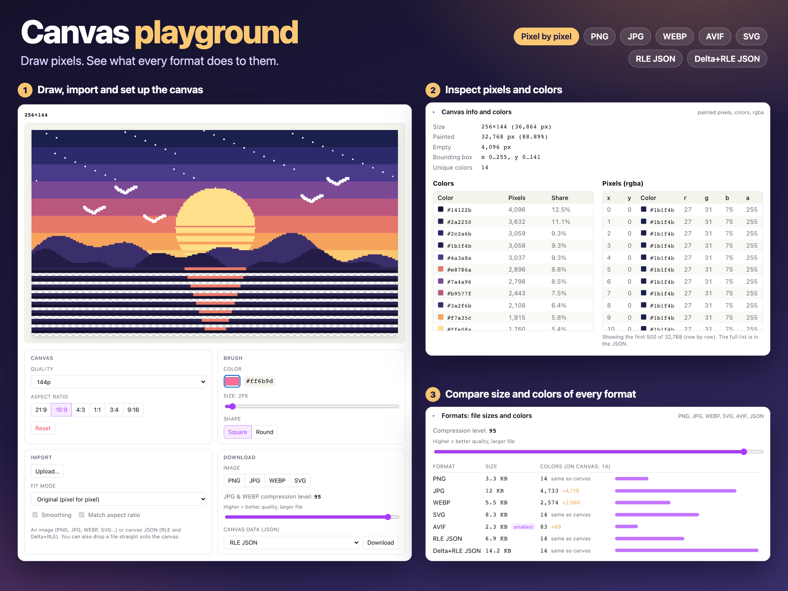

# Canvas playground

A pixel canvas for prototyping image-generation math: draw pixel by pixel, then see exactly what the canvas holds and what every export format makes of it.

**Live demo:** https://rah-emil.github.io/canvas-playground-debugger/



- **Draw & set up** — brush color, size and shape; 72p–4K canvases in 6 aspect ratios.
- **Import** — images (original size, fit, fill or stretch) and canvas JSON.
- **Inspect** — painted pixels, unique colors and rgba values.
- **Compare formats** — file size and color count for PNG, JPG, WEBP, AVIF, SVG, RLE JSON and Delta+RLE JSON, with a compression-level slider.

## Run

```bash
pnpm install
pnpm dev
```

`pnpm test` runs unit tests, `pnpm test:e2e` browser tests (needs Google Chrome), `pnpm poster` regenerates the poster above.
